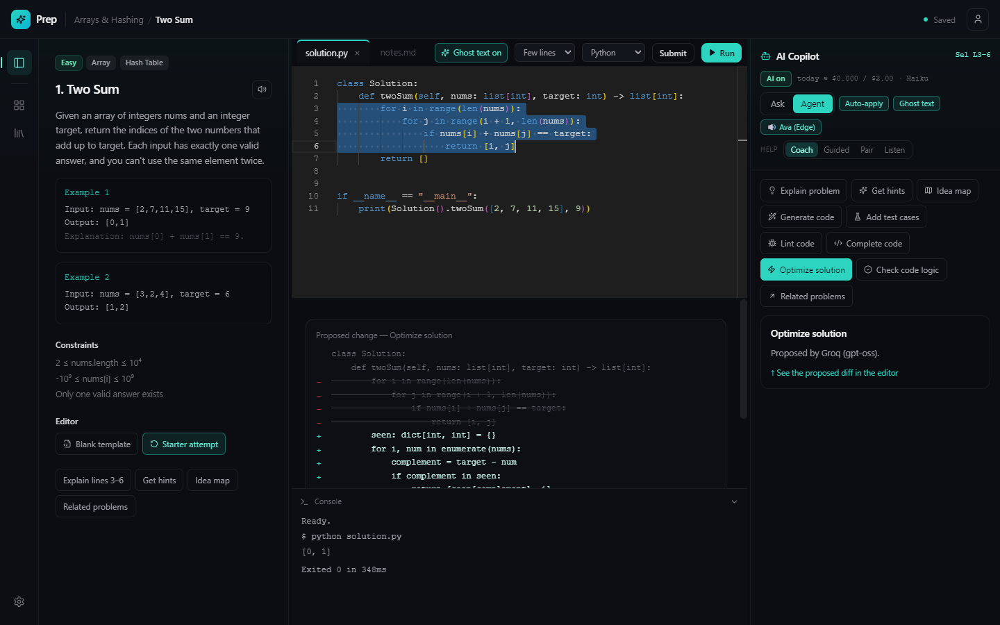
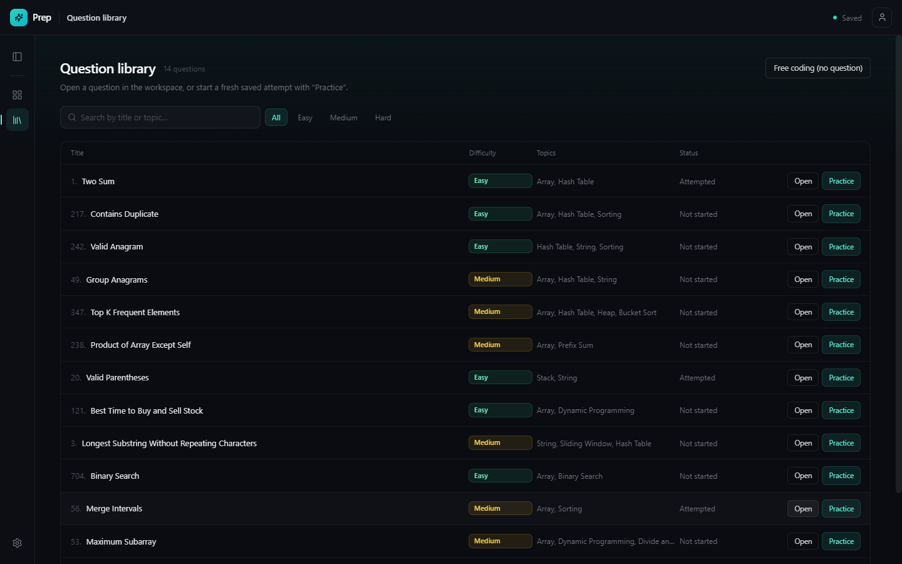

<div align="center">


# Prep

### Practice coding interviews *out loud.*

An interview-prep IDE with a voice: a real Monaco editor, a LeetCode-style problem library, and an AI copilot you can **talk to**, interrupt, and point at your code.

[](https://github.com/OWNER/REPO/actions/workflows/ci.yml)


[](LICENSE)

<br />


<sub>Real app, real model calls. Recorded with <a href="scripts/record-demo.mjs"><code>scripts/record-demo.mjs</code></a>.</sub>

</div>

---

## Why

Most people practice coding interviews alone and in silence, but real interviews happen **out loud**. Prep is the editor I wanted for that: you talk through your approach, the copilot hears you, sees exactly what is on your screen, and answers by voice, and you can talk over it the way you would a human interviewer.

> **Watch the 2-minute walkthrough:** *add the video link here (LinkedIn / YouTube).*

## Features

| | |
|---|---|
| 🎙️ **Talk to it** | Local speech-to-text ([Parakeet](https://huggingface.co/nvidia/parakeet-tdt-0.6b-v3)) and text-to-speech (Edge TTS "Ava" or Kokoro). Replies stream back **sentence by sentence**, so she starts speaking while the model is still writing. |
| ✋ **Barge-in** | Talk over the assistant and she ducks, then stops mid-sentence. The model stream is cancelled and the copilot knows what you didn't hear. |
| 👀 **It sees your code** | Every turn carries the file with line numbers, your caret, your selection, and a diff of what you changed since its last reply. |
| 🖱️ **Highlight-first** | "Go to line 12", "highlight lines 3 to 6 and explain it". Navigation runs locally and instantly, with no model call. |
| ✍️ **Ghost text** | Copilot-style inline completions in Monaco (Tab to accept), aware of the conversation and comment-aware. |
| 🧠 **Choose your help** | **Coach** (hints, never the answer), **Guided** (one step at a time), **Pair** (does what you ask), **Listen** (quiet until asked). |
| ⚡ **10 one-click agents** | Explain, hints, idea map, generate, test cases, lint, complete, **Optimize** (returns an Accept/Reject diff), check logic, related problems. |
| 🗂️ **Question library & playgrounds** | 14 seeded problems (arrays, stacks, sliding window, binary search, intervals, DP). Every attempt is its own saved playground, plus a free-coding mode. |
| ▶️ **Real execution** | Run Python locally and see the output in the console. |
| 🛑 **Spend brakes** | Daily budget, rate brake, echo guard, prompt caps, and a live spend meter, because voice loops get expensive fast. |

<table>
<tr>
<td width="50%"><br /><sub><b>Agent chips</b> and a reviewable Optimize diff</sub></td>
<td width="50%"><br /><sub><b>Question library</b> with search and difficulty filters</sub></td>
</tr>
</table>

## Quick start

**Requirements:** Node.js 20+, and at least one model API key ([Anthropic](https://console.anthropic.com/), [Groq](https://console.groq.com/keys) or [Gemini](https://aistudio.google.com/apikey)). Python 3 is needed to **run** Python solutions and for the **voice** sidecar. Developed and tested on **Windows 11**; macOS and Linux should work for the editor and chat but are untested for voice.

```bash
git clone https://github.com/OWNER/REPO.git prep
cd prep
npm install

cp .env.example .env        # then add at least one API key (Windows: copy .env.example .env)
npm run dev
```

That is enough for the editor, the copilot chat, agent chips and ghost text. API keys are read **only by the Electron main process** and never reach the renderer.

### Enable voice (optional)

```bash
python -m venv .venv
.venv\Scripts\activate                       # macOS/Linux: source .venv/bin/activate
pip install -r voice/requirements.txt
# then in .env:  VOICE_PYTHON=<full path to that venv's python>
```

Click the mic in the copilot panel; the app starts the sidecar for you. The first run downloads the Parakeet model (about 2.4 GB). For GPU speed-ups see [docs/voice.md](docs/voice.md). Headphones are strongly recommended.

## Configuration

Everything lives in `.env` (copied from [`.env.example`](.env.example)):

| Variable | Purpose |
|---|---|
| `ANTHROPIC_API_KEY` / `GROQ_API_KEY` / `GEMINI_API_KEY` | At least one. Groq, when present, is also used for fast ghost-text. |
| `VOICE_PYTHON` | Python interpreter for the **voice sidecar** only. Blank means `py -3` (Windows) or `python3`. (Running your solutions uses whichever `py`/`python`/`python3` is on `PATH`.) |
| `PARAKEET_MODEL`, `PARAKEET_DEVICE` | Speech model id, and `auto \| cuda \| cpu`. |

Provider, model, help style, ghost-text style, voice and the daily budget are changed in-app under **Settings**.

## Scripts

| Command | What it does |
|---|---|
| `npm run dev` | Electron + Vite with hot reload |
| `npm run build` / `npm start` | Production build / preview the build |
| `npm run typecheck` · `npm run lint` · `npm test` | Static checks and unit tests (no API calls) |
| `npm run smoke` | Drives the **built** app end to end with Playwright (about 10k tokens) |
| `npm run logs` | Read per-run session logs without opening them raw |
| `npm run demo` | Re-records the README demo on a throwaway profile (`DEMO_PROVIDER=groq OUT_DIR=docs/media`) |

## How it works

```
mic ─► renderer (echo cancel, 16 kHz) ─ws─► Python sidecar: Silero VAD ─ Smart Turn ─ Parakeet ─► text
   ─► Electron main: provider.stream() ─► tokens ─► SentenceChunker ─ws─► Edge TTS / Kokoro ─► audio
   you talk over it ─► sidecar "barge-in" ─► audio stops + model request cancelled
```

The brain deliberately stays in Electron, where it sees the question and the live editor buffer and holds the keys. The sidecar is only ears and mouth, so it stays small, fast and swappable.

| Layer | Tech |
|---|---|
| Shell & UI | Electron, React 18, Tailwind, Zustand, Monaco |
| Voice | Python, Silero VAD, Smart Turn v3.2, Parakeet TDT 0.6B v3 (ONNX), Edge TTS / Kokoro, WebSocket |
| Models | Anthropic Claude, Groq (`gpt-oss-120b`), Gemini, streamed over SSE |

## Documentation

- [Architecture](docs/architecture.md): process model, IPC, state, folder map
- [Voice pipeline](docs/voice.md): sidecar protocol, end-of-turn detection, barge-in, tuning, GPU setup
- [Copilot behaviour](docs/copilot.md): what the model sees, editor commands, help styles, ghost text
- [Spend brakes & costs](docs/spend-and-costs.md): what costs credits and how it is capped
- [Testing & debugging](docs/testing.md): scripts, session logs, turn logs

## Roadmap

- [ ] Echo *detection* gate fed with what the renderer actually played (open-speaker use)
- [ ] Kokoro as the default for fully offline speech
- [ ] Real language server (pyright) beside the AI ghost text
- [ ] Stronger sandboxing for Run/Submit (today: temp dir + timeout)
- [ ] More languages for local execution, "Upload from file" and "Generate with AI" questions

## Contributing

Issues and PRs are welcome. See [CONTRIBUTING.md](CONTRIBUTING.md). Please never commit `.env` or paste live keys into issues or logs.

## License

[Apache License 2.0](LICENSE) © 2026 Anas Nasseur
